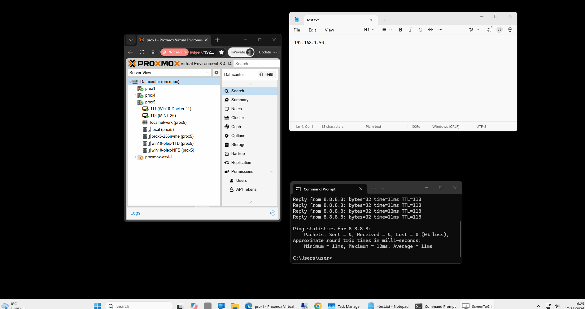

# CtrlIt

**Point at an IP address or hostname anywhere in Windows (or tap Ctrl on it) and get Ping, Traceroute, RDP, SSH, PowerShell diagnostics and more, without copying, pasting or typing it.**

CtrlIt is a tiny tray app for sysadmins and network engineers. It works wherever the address already is: Command Prompt, PowerShell, MobaXterm, Notepad, Outlook, Teams, a browser, even a screenshot or a remote desktop window.



## Features

- **Hover to detect.** Rest the mouse on an IPv4 or IPv6 address for half a second and a menu appears beside it.
- **Hostnames too.** Tap Ctrl, or hold it for half a second, over any word to treat it as a hostname.
- **Works in terminals.** For apps that draw their own text (MobaXterm, some consoles, RDP windows, screenshots), it falls back to Windows' built-in text recognition (OCR) on a small area around the mouse.
- **Clipboard.** Press Ctrl+Alt+I to act on an IP or hostname you've copied.
- **One .exe, no installer.** Settings are kept in the registry under your user account.

### Actions

| Group | Actions |
|---|---|
| Basic | Ping, Ping -a, Traceroute, Pathping, Nslookup, Copy |
| Connect | RDP, SSH, open in browser (http / https), open file share (`\\host`) |
| Network tests (from your PC) | Test a TCP port, test common ports, Resolve-DnsName (plain / -Type A / -Server), your connections to it and the owning process, route (Find-NetRoute), ARP / neighbour entry |
| Remote PowerShell (on the target) | IP configuration, NICs, NIC errors and discards, routes, ARP cache, listening ports and established connections with owning process, firewall profiles and rules, OS details, hotfixes, processes, services, stopped automatic services, event log errors (24 h), CPU / memory / disk latency counters, disks and volumes, storage reliability counters, failover cluster, nodes and resources |
| PsTools | PsExec (remote cmd, ipconfig), PsInfo, PsLoggedOn, PsList, PsService |

## Download

Get `ctrlit.exe` from the [latest release](../../releases/latest), put it anywhere and run it. Look for the blue **Ctrl** key icon in the system tray; right-click it for options, including **Start with Windows**.

Requires Windows 10 or 11 (or Windows Server 2016 or later) with .NET Framework 4.x, which is built in.

## Requirements for some actions

- **Remote PowerShell** actions need WinRM enabled on the target (`Enable-PSRemoting`, on by default on Windows Server) and admin rights there. When you hover an IP address, CtrlIt looks up its name first, because WinRM won't accept a bare IP unless it's in TrustedHosts.
- **PsTools** aren't part of Windows and can't be bundled. Download [PsTools](https://learn.microsoft.com/sysinternals/downloads/pstools) and put the files next to `ctrlit.exe`, in `C:\PSTools`, or anywhere on your PATH. If they aren't found, CtrlIt runs them from Microsoft's `\\live.sysinternals.com` share.
- **Elevated windows:** to read text from windows running as administrator, run CtrlIt as administrator too.

## Privacy

CtrlIt makes no network connections of its own and collects nothing.

- **Reading text:** it reads the text under the mouse through Windows UI Automation. When that doesn't work, it reads a small snapshot (about 460 × 64 pixels) around the cursor with Windows' built-in OCR. The snapshot is held in memory only, never saved, and never leaves your PC.
- **Ctrl detection:** to notice a Ctrl tap it checks whether keys are currently held down. It does not record what you type.
- **On-demand mode:** if you prefer, turn on **Only while Ctrl is held** in the tray menu so nothing is read unless you ask.

## Building from source

No Visual Studio needed. The C# compiler that ships with Windows is enough:

```
build.bat
```

This compiles `CtrlIt.cs` into `ctrlit.exe` and starts it. Compiler output is saved in `build.log`. `build.bat ci` only compiles, which is what the release workflow uses.

## Releases

Publishing a release on GitHub (for example with tag `v1.0.0`) runs the workflow in `.github/workflows/release.yml`, which builds `ctrlit.exe` on a clean Windows machine and attaches it to that release.

## Support the project

CtrlIt is free and open source. If it saves you time, you can support its development via [Ko-fi](https://ko-fi.com/ctrlittools) or the **Sponsor** button at the top of this page.

## Licence

[MIT](LICENSE)
